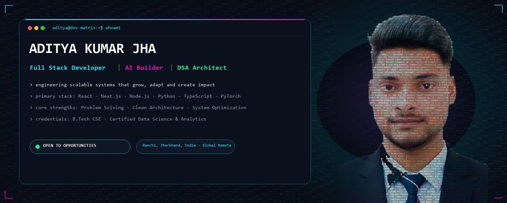
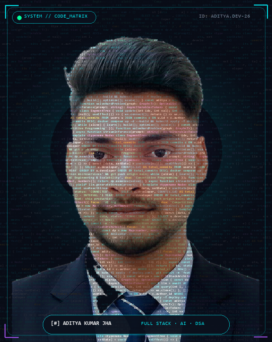
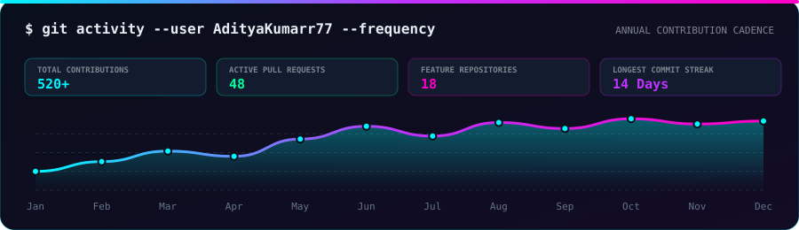
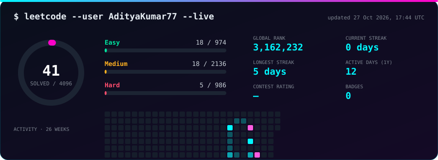
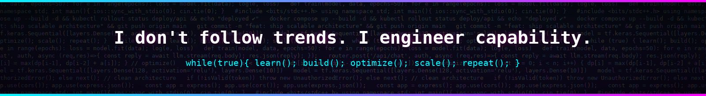

<div align="center">




<br/>

[](https://www.linkedin.com/in/adityakumarjha999)
[](mailto:technicaladityarathore@gmail.com)
[](https://leetcode.com/u/AdityaKumar77/)
[](https://unstop.com/u/technadi29148)
[](https://www.instagram.com/devilbuoy757/)


</div>

---

## 👨‍💻 Engineering Profile & Philosophy

<table>
<tr>
<td width="38%" align="center" valign="top">

</td>
<td valign="top">

```ts
const aditya: SoftwareEngineer = {
  name:        "Aditya Kumar Jha",
  role:        "Full Stack Developer · AI Builder · Problem Solver",
  education:   "B.Tech in Computer Science & Engineering",
  location:    "Ranchi, Jharkhand, India 🇮🇳 (Available Globally)",
  coreStrengths: [
    "Algorithmic Optimization & DSA",
    "Scalable Full-Stack Architecture",
    "Production AI & LLM Systems",
  ],
  certifications: [
    "Certified in Data Science & Analytics",
    "Advanced Software Engineering Simulations",
  ],
  engineeringMotto: "Logic first. Scale second. Impact always.",
  status: "Actively interviewing for SDE Intern & Full-Time Roles 🚀",
};
```

I approach software engineering from first principles: **Data Structures and Algorithms** form the core foundation of my thought process, which I connect with modern **Full Stack Architecture and Generative AI** to deliver real-world software products that scale.

Whether it is reducing P99 latency in a backend stream, designing reactive frontend interfaces with pixel precision, or embedding machine learning into practical workflows, I focus on **clean code, measurable impact, and rapid execution.**

</td>
</tr>
</table>

### ⚡ What I Bring to Your Engineering Team
- 🧠 **Strong DSA Problem-Solving**: Daily practitioner of competitive programming; intuitive grasp of graph algorithms, dynamic programming, and data structures.
- 🚀 **Full-Stack Execution Speed**: Ship end-to-end features rapidly with React, Next.js, Node.js, and Python.
- 🤖 **AI-Native Mindset**: Real experience integrating LLMs, vector search, streaming APIs, and neural network models into functional apps.
- 🛡️ **Production Quality**: Security-first code with thorough input validation, responsive UI design, and containerized deployments.

---

## 🚀 Featured Engineering Projects

| Project | Description & Architecture | Tech Stack | Quick Links |
|:---|:---|:---|:---:|
| 💬 **[ChatVerse](https://github.com/AdityaKumarr77/ChatVerse)** | ChatGPT-caliber full-stack AI platform with real-time token streaming, history persistence, and responsive UI. | React · Node.js · LLM API · Tailwind | [Repo](https://github.com/AdityaKumarr77/ChatVerse) |
| 🛒 **[RanchiKart](https://github.com/AdityaKumarr77/RanchiKart)** | High-performance regional e-commerce portal with real-time cart state, catalog search, authentication & order flow. | Full Stack · React · Node · MongoDB | [Repo](https://github.com/AdityaKumarr77/RanchiKart) |
| 🖥️ **[ADITYA.OS](https://github.com/AdityaKumarr77/ADITYA.OS)** | Interactive portfolio designed as a desktop operating system with window management, terminal emulator, and apps. | JavaScript · CSS3 · HTML5 | [Repo](https://github.com/AdityaKumarr77/ADITYA.OS) |
| 📄 **[Scanline](https://github.com/AdityaKumarr77/Scanline)** | Intelligent ATS resume scorer parsing resume structures, analyzing keywords, and giving heuristic optimization tips. | Web · NLP Heuristics · JavaScript | [Repo](https://github.com/AdityaKumarr77/Scanline) |
| 🛡️ **[Site Security Inspector](https://github.com/AdityaKumarr77/Security-Inspector)** | Chrome/Firefox MV3 extension auditing CSP headers, cookie security flags, permissions, and outdated client libraries. | JavaScript · Chrome MV3 · Web APIs | [Repo](https://github.com/AdityaKumarr77/Security-Inspector) |
| ✍️ **[Inkwell](https://github.com/AdityaKumarr77/Inkwell)** | Canvas workstation with pen pressure, text overlays, calligraphy smoothing, and PDF/DOCX/TXT multi-format export. | JavaScript · HTML5 Canvas · Export APIs | [Repo](https://github.com/AdityaKumarr77/Inkwell) |
| 🌦️ **[Skycast](https://github.com/AdityaKumarr77/Skycast)** | Real-time weather radar & forecast platform featuring dynamic animated backgrounds and geolocation services. | JavaScript · Weather APIs · CSS Grid | [Repo](https://github.com/AdityaKumarr77/Skycast) |
| 🎸 **[Guitar Tuner](https://github.com/AdityaKumarr77/Guitar-Tuner)** | In-browser acoustic & electric guitar tuner with FFT pitch detection running in real time via Web Audio API. | Web Audio API · DSP · Canvas | [Repo](https://github.com/AdityaKumarr77/Guitar-Tuner) |

---

## 🛠️ Tech Arsenal & Skill Matrix

<div align="center">

<table>
<tr>
<td align="center" width="16%"><strong>Languages</strong></td>
<td align="center">

</td>
</tr>
<tr>
<td align="center" width="16%"><strong>Frontend</strong></td>
<td align="center">

</td>
</tr>
<tr>
<td align="center" width="16%"><strong>Backend & APIs</strong></td>
<td align="center">

</td>
</tr>
<tr>
<td align="center" width="16%"><strong>Databases</strong></td>
<td align="center">

</td>
</tr>
<tr>
<td align="center" width="16%"><strong>Cloud & DevOps</strong></td>
<td align="center">

</td>
</tr>
<tr>
<td align="center" width="16%"><strong>AI, ML & Data</strong></td>
<td align="center">


</td>
</tr>
<tr>
<td align="center" width="16%"><strong>Engineering Tools</strong></td>
<td align="center">


</td>
</tr>
</table>

</div>

---

## 📊 GitHub Analytics & Work Metrics

<div align="center">


<br/>


</div>

### 📈 Annual Contribution Cadence

<div align="center">



</div>

### 🐍 Contribution Activity Snake

<div align="center">

<picture>
  <source media="(prefers-color-scheme: dark)" srcset="assets/github-contribution-grid-snake-dark.svg">
  <source media="(prefers-color-scheme: light)" srcset="assets/github-contribution-grid-snake.svg">
  
</picture>

<sub>⚡ The snake game continuously navigates and consumes my GitHub contribution matrix. Auto-refreshed via GitHub Actions.</sub>

</div>

---

## 🧩 Problem Solving — Live LeetCode Dashboard

<div align="center">

<a href="https://leetcode.com/u/AdityaKumar77/">
  
</a>

<sub>⚡ Auto-refreshed directly from the LeetCode GraphQL API via GitHub Actions.</sub>

<br/><br/>

<a href="https://leetcode.com/u/AdityaKumar77/">
  
</a>

</div>

---

## 🤝 Let's Connect & Build

I am actively looking for **Software Engineering Internships, Graduate Roles, and Full-Stack / AI opportunities.** If you are looking for an engineer with strong algorithmic rigor, high shipping velocity, and a passion for clean systems, let's talk !

<div align="center">

📫 **[technicaladityarathore@gmail.com](mailto:technicaladityarathore@gmail.com)** &nbsp;•&nbsp; 💼 **[LinkedIn](https://www.linkedin.com/in/adityakumarjha999)** &nbsp;•&nbsp; 🧩 **[LeetCode](https://leetcode.com/u/AdityaKumar77/)** &nbsp;•&nbsp; 🏆 **[Unstop](https://unstop.com/u/technadi29148)**

<br/>



</div>
